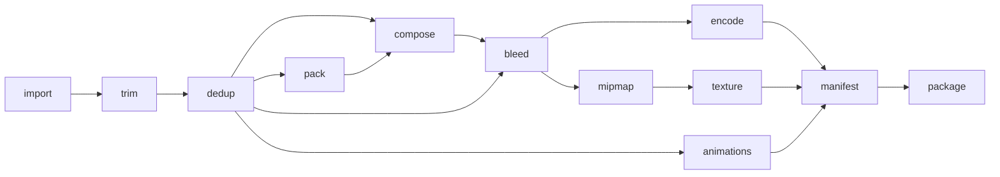

# Pipeline

Packing is a deterministic sequence of passes. Each pass declares typed input and output ports; the runner resolves references of the form `pass.port` and executes nodes in dependency order.



| Pass | Input | Output |
| --- | --- | --- |
| `import.frames` | source files | frame set |
| `trim.fit-pixel` | frame set | frame set |
| `store.deduplicate` | frame set | frame set |
| `pack.maxrects` / `pack.basic` | frame set | page layouts |
| `compose.page` | frames, layouts | page images |
| `bleed.page` | page images, frames | page images |
| `mipmap.page` | page images | mip chains |
| `encode.page` | page images | raster variants |
| `texture.encode` | page images or mip chains | KTX2 variants |
| `build.animations` | frame set | animation drafts |
| `manifest.build` | frames, pages, animations | manifest and files |
| `package.directory` | manifest and files | directory or bundle |

## Cache

The cache lives in `.sloom-cache/` under the project directory. A pass is cached only when it is deterministic and cacheable. The cache key combines the pass id and version, its parameters, and the content of every input artifact.

- A hit restores the serialized output and emits `SL3100` at info severity.
- A miss executes the pass and writes a new entry.
- `pack` reports hit and miss counts at the end of a build.
- `--refresh` bypasses reads and rebuilds all passes.
- `--no-cache` disables reads and writes for the run.

The import pass also includes source path, size, and modification time in its key, so adding or editing a source file invalidates it.

## Watch mode

```bash
sloom pack --watch
```

Watch mode rebuilds after a change to the configuration file or any configured source. Each rebuild uses the normal cache rules; `--refresh` forces a full rebuild on every iteration. Press Ctrl+C to stop.

## MSBuild

Import [`build/SpriteLoom.targets`](../../build/SpriteLoom.targets) and enable it:

```xml
<Project>
  <Import Project="build/SpriteLoom.targets" />
  <PropertyGroup>
    <SpriteLoomEnabled>true</SpriteLoomEnabled>
    <SpriteLoomConfig>sloom.toml</SpriteLoomConfig>
    <SpriteLoomCli>dotnet tools/SpriteLoom.Cli.Jit.dll</SpriteLoomCli>
  </PropertyGroup>
</Project>
```

`SpriteLoomPack` runs before `Build`. Set `SpriteLoomRefresh` to `true` to pass `--refresh`.

## Determinism

Every pass that contributes to normative output is deterministic. Package bytes depend only on source content and configuration; cache hits restore byte-identical artifacts.
