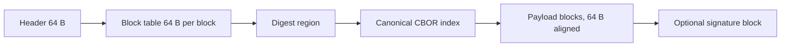

# Package format

A package is either a directory tree or a single `.slb` bundle. Both carry the same manifest, page containers, encoded images, and animation documents.

## Directory package

```text
build/heroes/
  manifest.json
  page/0000.slatlas/
    container.json
    v0.png
  anim/
    run.anim.json
  signatures/
    <key-id>.sig.cbor
```

- `manifest.json` or `manifest.cbor` indexes URIs, pages, frame records, and animations.
- Each `<page>.slatlas/` directory is a container: one metadata file and one or more content variants.
- Variant order in the manifest is the fallback order. If any frame in a variant cannot be loaded, the whole container falls back to the next variant.
- Animation files are addressed by `anim:` IRIs and contain frame indices, per-frame durations, playback defaults, and optional key-value extras.

The `signatures/` directory is present only in signed packages.

## Bundle

`.slb` is a little-endian container designed for whole-package reads and memory mapping.



Header fields include the magic `53 4C 42 1A`, format version, flags, file size, block count, block-table offset, index offset and size, and an index CRC32. Every block entry records its offset, stored and raw sizes, kind, codec, flags, checksum mask, and digest offset.

A writer may append an optional 64-byte footer. It repeats the index offset and size and carries its own CRC32, allowing sequential readers to locate the index without seeking back to the header.

Block kinds:

| Value | Kind |
| --- | --- |
| 1 | Manifest |
| 2 | Container |
| 3 | Animation |
| 4 | Image |
| 5 | Mesh |
| 6 | Blob |
| 7 | Signature |

The index maps package paths to block ids and records the feature set. Readers reject missing blocks, duplicate paths, out-of-range offsets, and checksum mismatches.

Checksums are combinable. The default is `xxh3-64`; `crc32`, `blake3`, `sha1`, `sha256`, and `sha512` may be enabled together. The digest region stores one digest per enabled algorithm per block.

## Encryption

`.slb` payload blocks may be encrypted with AES-256-GCM or XChaCha20-Poly1305. Encryption is applied per block after compression:

1. Split the plaintext block into chunks (default 64 KiB).
2. Derive a block key with `HKDF-SHA256(master, salt, "slb-block" || key-id || block-id)`.
3. Encrypt each chunk with a nonce built from the algorithm-specific prefix and a little-endian chunk index.
4. Append the 16-byte tag to each chunk and zero-pad the stored block to a 64-byte boundary.

The index `crypto` array stores `key-id`, `alg`, `kdf`, `salt`, `nonce-prefix`, and `chunk-size`. Each encrypted block entry has `ENCRYPTED` set and records `chunk-count` and `key-id`; `raw-size` is the plaintext length. The signature block is never encrypted. Checksums and signatures cover plaintext, so signing does not depend on encryption.

The header `EncryptedIndex` flag is reserved for encrypted indexes; current writers leave the navigation structures unencrypted. Readers that encounter an encrypted payload without a key fail with `SL5022`.

Directory packages use the standalone `.senc` container for each file. The manifest keeps logical paths; readers strip the `.senc` suffix after decryption. Directory signatures cover the stored `.senc` files, so signature verification does not require the symmetric key.

## Determinism

Given identical inputs and configuration, a package is byte-identical across runs. Passes sort their outputs with ordinal comparisons and avoid timestamps in normative content.
