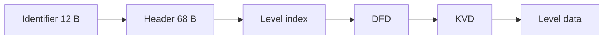

# Textures and pixel formats

SpriteLoom can emit raster variants and GPU block-compressed variants for the same page. All variants share the page dimensions and the frame rectangles stored in the container.

## Pixel formats

| Name | Layout | Bytes per pixel | Notes |
| --- | --- | --- | --- |
| `rgba8888` | R G B A | 4 | Default |
| `bgra8888` | B G R A | 4 | Backend compatibility |
| `rgb888` | R G B | 3 | Opaque pages only |
| `rgb565` | R5 G6 B5 | 2 | Opaque pages only |
| `rgba4444` | R4 G4 B4 A4 | 2 | Alpha-aware quantization |
| `r8` | luminance | 1 | Masks and single-channel data |

`rgb888` and `rgb565` reject pages containing non-opaque pixels with `SL3010`.

## Dither

| Mode | Matrix |
| --- | --- |
| `none` | Truncation with rounding |
| `ordered4` | 4x4 Bayer matrix |
| `ordered8` | 8x8 Bayer matrix |

Quantization is integer-only. The alpha channel uses a phase-shifted threshold for `rgba4444` so semi-transparent edges do not develop a checkerboard pattern.

## Raster variants

`encode.page` accepts a `formats` list. PNG is always written; additional formats are appended in order:

```toml
[[passes]]
id = "encode"
use = "encode.page"
params = { formats = ["png", "webp", "jxl", "avif"], quality = 90 }
```

WebP is encoded by Skia; JPEG XL and AVIF are encoded by Magick.NET. A JPEG variant is rejected for pages with transparency.

## GPU variants

`texture.encode` accepts a `targets` list:

| Target | Codec | Block |
| --- | --- | --- |
| `ktx2-astc4x4` / `6x6` / `8x8` / `12x12` | ASTC | 16 bytes |
| `ktx2-bc1` | BC1 | 8 bytes |
| `ktx2-bc3` | BC3 | 16 bytes |
| `ktx2-bc4` / `ktx2-bc5` | BC4 / BC5 | 8 / 16 bytes |
| `ktx2-bc7` | BC7 | 16 bytes |
| `ktx2-etc2-rgba` | ETC2 RGBA | 16 bytes |
| `ktx2-basis-uastc` | Basis UASTC | 16 bytes |
| `ktx2-basis-etc1s` | Basis ETC1S | 8 bytes |

Raw KTX2 targets are also available: `ktx2-rgba8888`, `ktx2-bgra8888`, `ktx2-rgb888`, `ktx2-rgb565`, `ktx2-rgba4444`, and `ktx2-r8`.

ASTC, BC, ETC2, and Basis Universal use the optional native encoder. If it is unavailable, the target is skipped with `SL3001` and the package keeps its remaining variants. Basis UASTC and ETC1S are emitted as complete KTX2 files with the required DFD, supercompression, and supercompression global data produced by basisu.

## KTX2 layout



- The identifier is `AB 4B 54 58 20 32 30 BB 0D 0A 1A 0A`.
- `vkFormat` is the sRGB variant for color targets.
- The DFD records block dimensions, channel layout, transfer function, and bytes per block.
- Levels are stored smallest to largest and indexed from the base level; each level starts on an 8-byte boundary.
- Page dimensions are aligned to the lowest common multiple of all target block dimensions, with a minimum alignment of 4.

## Mipmaps

The `mipmap.page` pass generates a box-filtered chain down to 1x1. Mip levels are encoded with the same target as the base level. Pages must remain aligned to every target block size at the base level; smaller levels are padded to whole blocks by the encoder.

## Diagnostics

| Code | Meaning |
| --- | --- |
| `SL3001` | Encoder unavailable or unknown target |
| `SL3002` | Variant encoding failed |
| `SL3003` | No usable variant |
| `SL3010` | Pixel format cannot represent the page alpha |
| `SL3020` | KTX2 write failed |
| `SL3030` | Page alignment violation |
| `SL3031` | Invalid mip level dimensions |
